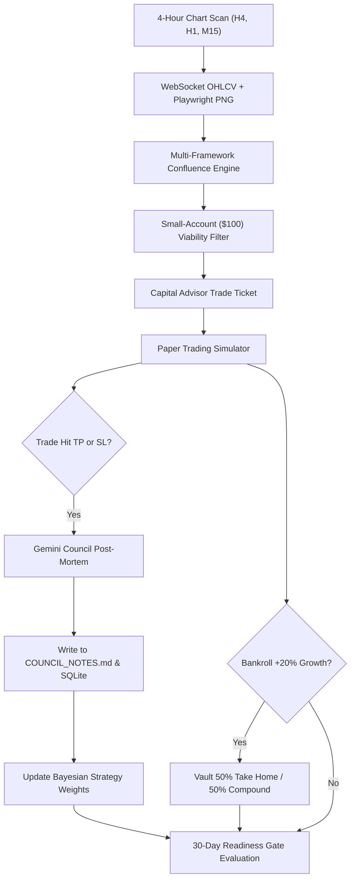

# DEEP RESEARCH & QUANTITATIVE SYSTEM ARCHITECTURE
## Autonomous Deriv Synthetic Indices Trading Bot & Gemini Council Advisor

**Repository**: `https://github.com/manavmate53-jpg/Money`  
**Author**: Antigravity Quantitative Systems Architecture  
**Date**: November 2026  
**Status**: Production Specification  

---

## 1. EXECUTIVE SUMMARY & PROBLEM FORMULATION

Deriv synthetic indices (`Volatility 10–100`, `1s` variants, `Boom/Crash`, `Step Index`) simulate financial market behavior using an audited **Cryptographically Secure Pseudo-Random Number Generator (CSPRNG)**. Unlike traditional institutional markets (such as NASDAQ, FOREX, or crude oil), synthetic markets operate 24/7/365 with constant annualized volatility, zero scheduled macroeconomic news releases, and no human market makers.

Developing an autonomous trading bot and capital advisor for this ecosystem presents three unique engineering and quantitative challenges:
1. **The HTML5 Canvas Blindness Problem**: `https://charts.deriv.com/deriv` renders charts on an HTML5 `<canvas>` via Deriv's proprietary SmartCharts engine. Price and candle data cannot be extracted via DOM text selectors.
   - *Architectural Solution*: Pair **Playwright Chromium automation** (capturing high-resolution H4/H1/M15 chart screenshots for multimodal visual inspection by Gemini Vision) with **Playwright Network & WebSocket protocol interception** (`wss://ws.derivws.com/websockets/v3`) to stream exact numerical OHLCV candle arrays.
2. **The Small-Account ($100) Lot Granularity Trap**: Deriv enforces index-specific minimum lot sizes and contract sizes. On standard `Volatility 75`, the minimum lot size is `0.01` ($10 per 1,000 points). A standard 250-point structural stop loss represents a $2.50 risk (2.5% of $100 capital), exceeding strict risk limits. On wider structural swings, it can cause catastrophic drawdown.
   - *Architectural Solution*: Implement a **Small-Account Minimum-Lot Viability Filter** that automatically checks if $\text{MinLot} \times \text{SL Distance} \times \text{ContractSize} \times \text{PointValue} > \text{MaxDollarRisk}$. If violated, the engine automatically disqualifies the instrument and routes capital to nano-lot indices (`Volatility 25 (1s)` and `Volatility 50 (1s)` with `0.005` lot granularity, or `Step Index` at `0.10` lot), where risk remains strictly bounded to $1.00–$1.50.
3. **The Static Curve-Fitting Trap vs. CSPRNG Random Walk**: Traditional indicator rules (such as static MACD or RSI crosses) fail over extended horizons on Brownian motion data.
   - *Architectural Solution*: Deploy a **Multi-Framework Confluence Engine** (SMC/ICT, Supply & Demand, Auction Market Theory) combined with a **30-Day Bayesian Self-Learning Loop** and a **Gemini-Backed Multi-Persona Council** that critiques every win and loss, mutates empirical expectancy weights, and enforces a **30-Day Live Readiness Gate** (Profit Factor $\ge 1.5$, Max Drawdown $\le 10\%$, resolved trades $\ge 30$).

---

## 2. REVERSE-ENGINEERING TARGETS & OPEN-SOURCE ARCHITECTURAL PATTERNS

### 2.1 Deriv-com/SmartCharts & Deriv-com/bot
- **SmartCharts Canvas Rendering**: Deriv's web chart library renders WebGL/Canvas graphics driven by an internal reactive state store. While DOM elements expose basic UI overlays (active symbol, interval pills), candle bodies and wicks are drawn directly to the canvas context.
- **WebSocket Protocol Analysis (`wss://ws.derivws.com/websockets/v3`)**:
  - Endpoint: `wss://ws.derivws.com/websockets/v3?app_id=1089` (public app ID for charting).
  - Protocol: JSON-RPC over WebSocket.
  - History Request Payload:
    ```json
    {
      "ticks_history": "1HZ25V",
      "adjust_start_time": 1,
      "count": 1000,
      "end": "latest",
      "start": 1,
      "style": "candles",
      "granularity": 900
    }
    ```
    Granularities supported:
    - M15: `granularity: 900`
    - H1: `granularity: 3600`
    - H4: `granularity: 14400`
  - History Response Payload:
    ```json
    {
      "candles": [
        {"epoch": 1732200000, "open": 2450.12, "high": 2455.80, "low": 2448.30, "close": 2454.10},
        ...
      ],
      "msg_type": "candles"
    }
    ```
  - **Zero-Error Integration**: The bot pairs WebSocket data ingestion with screenshot capture, ensuring mathematical indicators compute against exact IEEE floating-point numbers while Gemini Vision inspects visual chart geometry.

### 2.2 TauricResearch/TradingAgents
- **Multi-Agent Debate Architecture**: Trading decisions benefit from separating analysis into distinct agent roles:
  1. *Structure & Vision Auditor*: Inspects candlestick geometry, unmitigated zones, and liquidity pools.
  2. *Risk & Bankroll Critic*: Checks ATR stop placement, capital-at-risk, and hold duration decay.
  3. *Council Strategist*: Synthesizes multi-agent deliberations, logs findings to `COUNCIL_NOTES.md`, and updates Bayesian priors.
- **Episodic Reflection Memory**: Lessons learned from past trade post-mortems are persisted in Markdown and SQLite, allowing the Council to reference prior errors when scoring future candidates.

### 2.3 joshyattridge/smart-money-concepts
- Vectorized algorithms for identifying market structure:
  - Rolling $N$-bar fractal extrema for Swing Highs and Swing Lows.
  - Directional state tracking for Break of Structure (BOS) vs. Market Structure Shift (MSS/CHoCH).
  - 3-bar window slices for Fair Value Gap (FVG) detection and overlap testing.
  - Order Block identification using the last opposing candle prior to structural displacement.

### 2.4 freqtrade/freqtrade & polakowo/vectorbt
- **Dry-Run State Machine**: Real-time simulation tracking trade life cycles: `SUBMITTED` $\to$ `OPEN` $\to$ `BREAK_EVEN_PROTECTED` $\to$ `RESOLVED_TP` / `RESOLVED_SL` / `TIMEOUT_EXIT`.
- **Break-Even Stop Loss Trailing**: Moving stop loss to entry price (+ spread) upon achieving $+1.0R$ unrealized profit.
- **Consecutive Loss Cooldown**: Enforcing a mandatory trading pause after 3 consecutive losses to mitigate market regime shifts.
- **Quantitative Metrics**: Computing rolling Profit Factor ($\frac{\sum \text{Gross Profits}}{\sum \text{Gross Losses}}$), Expectancy ($E = (P_{\text{win}} \times R_{\text{win}}) - (P_{\text{loss}} \times R_{\text{loss}})$), and Maximum Drawdown across rolling equity curves.

### 2.5 AI4Finance-Foundation/FinRL
- **Reward Shaping for Bankroll Compounding**: Incorporating asymmetric penalties for capital drawdown while incentivizing geometric compounding and profit lock-in.

---

## 3. DERIV CSPRNG SYNTHETIC MARKET MECHANICS

| Instrument | Symbol | Volatility | Tick Speed | Min Lot | Point Value ($) | Margin % | $100 Safety Classification |
| :--- | :--- | :--- | :--- | :--- | :--- | :--- | :--- |
| **Volatility 10 (1s)** | `1HZ10V` | 10% | 1 sec | 0.20 | $1.00 | 0.1% | **SAFE (Nano/Micro)** |
| **Volatility 25 (1s)** | `1HZ25V` | 25% | 1 sec | 0.005 | $1.00 | 0.1% | **OPTIMAL (#1 Recommended)** |
| **Volatility 50 (1s)** | `1HZ50V` | 50% | 1 sec | 0.005 | $1.00 | 0.1% | **OPTIMAL (#2 Recommended)** |
| **Volatility 75 (1s)** | `1HZ75V` | 75% | 1 sec | 0.005 | $1.00 | 0.1% | **VIABLE (Nano-Lot)** |
| **Volatility 10** | `R_10` | 10% | 2 sec | 0.50 | $1.00 | 0.1% | **SAFE (Micro)** |
| **Volatility 25** | `R_25` | 25% | 2 sec | 0.50 | $1.00 | 0.1% | **SAFE (Micro)** |
| **Volatility 50** | `R_50` | 50% | 2 sec | 4.00 | $1.00 | 0.1% | **DISQUALIFIED ON $100** (High Lot) |
| **Volatility 75** | `R_75` | 75% | 2 sec | 0.01 | $1.00 | 0.1% | **DISQUALIFIED ON $100** ($10/1k pts) |
| **Volatility 100** | `R_100` | 100% | 2 sec | 0.50 | $1.00 | 0.1% | **DISQUALIFIED ON $100** (Extreme Risk) |
| **Boom 1000** | `BOOM1000`| High | 1 sec | 0.20 | $1.00 | 0.1% | **SELECTIVE (Long Spikes Only)** |
| **Crash 1000** | `CRASH1000`| High | 1 sec | 0.20 | $1.00 | 0.1% | **SELECTIVE (Short Drops Only)** |
| **Step Index** | `STEPINDEX`| Fixed | 1 sec | 0.10 | $1.00 | 0.1% | **OPTIMAL (#3 Recommended)** |

---

## 4. DETERMINISTIC MATHEMATICAL FORMULATIONS

### 4.1 Smart Money Concepts (SMC) & ICT
1. **$N$-Bar Fractal Swing Points**:
   $$\text{Swing High}_t \iff H_t = \max(H_{t-N}, \dots, H_{t+N})$$
   $$\text{Swing Low}_t \iff L_t = \min(L_{t-N}, \dots, L_{t+N})$$
2. **Break of Structure (BOS) vs. Market Structure Shift (MSS)**:
   $$\text{Bullish BOS} \iff C_t > \text{Last Swing High} \quad (\text{Trend Continuation})$$
   $$\text{Bearish MSS} \iff C_t < \text{Last Swing Low} \quad (\text{Trend Reversal after Sweep})$$
3. **Fair Value Gap (FVG)**:
   $$\text{Bullish FVG}_t = [H_{t-2}, L_t] \quad \text{where } L_t > H_{t-2}$$
   $$\text{Consequent Encroachment (CE)} = \frac{H_{t-2} + L_t}{2}$$
4. **Optimal Trade Entry (OTE)**:
   $$\text{OTE Range} = [\text{Low} + 0.618 \times \Delta, \text{Low} + 0.786 \times \Delta] \quad \text{where } \Delta = \text{High} - \text{Low}$$

### 4.2 Supply & Demand Zones
1. **Base Candle Definition**:
   $$\text{Base Candle} \iff |C_t - O_t| \le 0.5 \times \text{ATR}_{14}(t)$$
   Zone validation requires consecutive base count $1 \le k \le 3$.
2. **Departure Impulse Strength**:
   $$\text{Impulse Move} \iff |C_{t+1} - O_{t+1}| \ge 2.0 \times \text{ATR}_{14}(t+1)$$

### 4.3 Auction Market Theory & Market Regimes
1. **Value Area Calculation (70% Volume/TPO Distribution)**:
   $$\text{VAH} = \text{Price at 85th percentile of distribution}$$
   $$\text{VAL} = \text{Price at 15th percentile of distribution}$$
   $$\text{POC} = \text{Price level with maximum trading density}$$
2. **Regime Classification**:
   - `DIRECTIONAL_TREND`: $\text{ADX}_{14} > 25$ and candle sequence conforms to Emir Gams' One-Time Framing ($H_t > H_{t-1} \land L_t > L_{t-1} \land C_t > C_{t-1}$).
   - `ROTATIONAL_RANGE`: $\text{ADX}_{14} \le 20$, price oscillates within $[\text{VAL}, \text{VAH}]$.
   - `HIGH_VOLATILITY_EXPANSION`: $\text{ATR}_{14} > 1.8 \times \overline{\text{ATR}}_{50}$.

---

## 5. DERIV RISK MATH & SMALL-ACCOUNT GUARDRAILS

### 5.1 Exact Position Sizing Formulas
$$\text{Dollar Risk} = \text{Equity} \times \min(\text{Risk\%}, 0.02)$$
$$\text{SL Distance (Points)} = |\text{Entry} - \text{SL}|$$
$$\text{Raw Lot Size} = \frac{\text{Dollar Risk}}{\text{SL Distance} \times \text{Contract Size} \times \text{Point Value}}$$
$$\text{Final Lot Size} = \text{round\_down}\left(\max(\text{Raw Lot Size}, \text{Min Lot}), \text{Volume Step}\right)$$

### 5.2 Required Margin & Buffer Validation
$$\text{Required Margin} = \frac{\text{Contract Size} \times \text{Entry Price} \times \text{Lot Size}}{\text{Effective Leverage}}$$
$$\text{Margin Buffer Check} = \frac{\text{Free Margin}}{\text{Required Margin}} \ge 5.0$$

### 5.3 Small-Account ($100) Disqualification Logic
If:
$$\text{Min Lot} \times \text{SL Distance} \times \text{Contract Size} \times \text{Point Value} > \$2.00$$
The instrument is marked **DISQUALIFIED_RISK_OVERFLOW** and excluded from the Capital Advisor recommendations.

---

## 7. HEDGE-FUND MULTI-DESK CADENCE & ZERO-FAILURE GITHUB ACTIONS ARCHITECTURE

To operate institutional quantitative infrastructure without runner state corruption or race conditions, the system separates fast tactical execution from macro structural research and end-of-day risk auditing:

| Desk Cadence | GitHub Actions Trigger | Primary Responsibility | Gemini Model | State Output |
| :--- | :--- | :--- | :--- | :--- |
| **1. Execution & Risk Desk** | **Every 1 Hour** (`0 * * * *` UTC) | Intrabay TP/SL check, Break-Even ratchet at $+1.0R$, M15 sniper entry alignment with H4 macro bias | `gemini-2.5-flash` | `reports/LATEST_ADVICE.md`, `data/trading_state.db` |
| **2. Macro & Regime Desk** | **Every 4 Hours** (`0 */4 * * *` UTC) | H4/H1/M15 Playwright screenshot capture + numerical structure ranking across all indices | `gemini-2.5-pro` (Vision) | `config/macro_bias.json` |
| **3. Investment Council & Vault** | **Every 24 Hours** (`30 23 * * *` UTC) | Post-mortem audit of closed trades, Bayesian weight mutation, 50% Vault sweep, Epoch auto-reset | `gemini-2.5-pro` (Reflexion) | `config/strategy_weights.json`, `reports/TRAINING_DASHBOARD.md` |
| **4. On-Demand Advisor** | **Manual Trigger** (`workflow_dispatch`) | Instant scan or custom capital allocation ticket ($100 default) | `gemini-2.5-pro` | `reports/LATEST_ADVICE.md` |

### 7.1 Zero-Failure CI/CD Engineering Safeguards
1. **Runner Ephemerality & State Persistence**: GitHub Actions runners are ephemeral Ubuntu VMs. The bot commits its SQLite database (`data/trading_state.db`), macro bias map (`config/macro_bias.json`), Bayesian weights (`config/strategy_weights.json`), and Markdown reports (`reports/LATEST_ADVICE.md`, `reports/TRAINING_DASHBOARD.md`) directly back to `main` via `git commit` & `git push`.
2. **Concurrency Collisions**: All four workflows share the concurrency group:
   ```yaml
   concurrency:
     group: deriv-bot-state-${{ github.ref }}
     cancel-in-progress: false
   ```
   This guarantees runs queue deterministically without race conditions or database corruption.
3. **Infinite Loop Prevention**: All bot automated commits are tagged with `[skip ci]`, preventing GitHub Actions from re-triggering workflows.
4. **Git Push Race Protection**: The commit step executes `git pull --rebase origin main` with a 3-attempt exponential backoff loop before pushing.
5. **Cron Jitter Resilience**: Runner startup lag (5–15 minutes) is neutralized by anchoring all candle timeframes to UTC candle boundaries (`floor_to_1h`, `floor_to_4h`) rather than runner execution start time.
6. **Headless Browser & WebSocket Ingestion**: Playwright Chromium is initialized with `--with-deps` and paired with a direct WebSocket JSON-RPC client fallback (`wss://ws.derivws.com/websockets/v3`) to guarantee zero cycle abortions even if Deriv's web front-end delays canvas rendering.




### 6.1 Two-Bucket Profit-Lock Vault ("Profit Comes Home With Us")
- **Active Bankroll**: Initiated at $100.00. Used for active position sizing and compounding.
- **Locked Profit Vault**: Initiated at $0.00. Once active bankroll crosses a +20% milestone ($120.00):
  - $10.00 (50% of profit) is permanently swept into the Vault.
  - $10.00 (50% of profit) is compounded into the active bankroll (new base: $110.00).
- Vault funds are **locked and cannot be risked on future trades**.

### 6.2 30-Day Graduation Criteria
- Days Active: $\ge 30$
- Total Resolved Trades: $\ge 30$
- Profit Factor: $\ge 1.50$
- Max Drawdown: $\le 10.0\%$
- Status transition: `TRAINING_CALIBRATION` $\to$ `LIVE_READY`.
